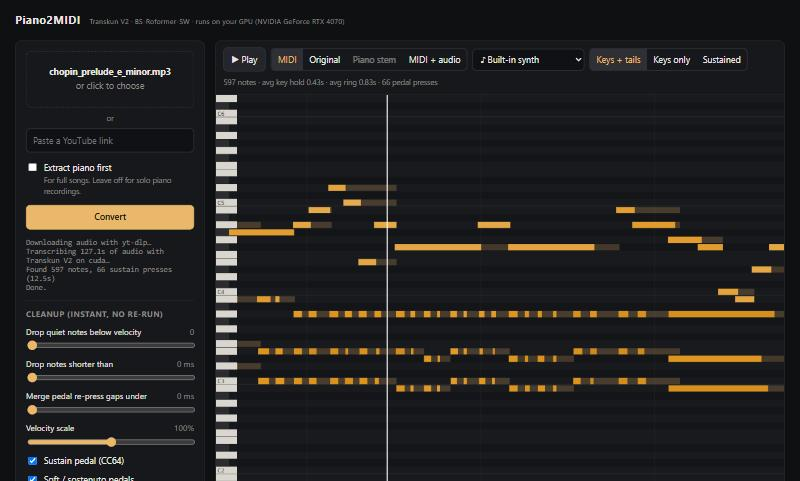

# Piano2MIDI

Turn piano recordings into MIDI, locally on your GPU, with **real key-press lengths** and the **sustain pedal kept separately** as CC64.

Drop a file or paste a YouTube link. Optionally isolate the piano from a full song first. Check the result on a piano roll, play it back (or straight into Pianoteq), and download the MIDI.



## Why the notes come out right

Most open piano transcription models (ByteDance's high-resolution model, Onsets & Frames) are trained on MAESTRO with every note **stretched until the sustain pedal lifts**. They predict how long a note *rings*, not how long the key was *held*. Under pedal you get long smeared notes, and post-processing can only guess where to cut them.

Piano2MIDI uses **[Transkun V2](https://github.com/Yujia-Yan/Transkun)** (Yan & Duan, ISMIR 2024). Its released checkpoint is trained **without** pedal extension. Notes end when the key lifts, and sustain, sostenuto and soft pedal are transcribed as their own events. It's also more accurate than the older models.

For full songs, **[BS-Roformer-SW](https://github.com/openmirlab/bs-roformer-infer)** separates the piano stem first.

## Features

- Audio or video files (anything FFmpeg reads) or **YouTube links** via yt-dlp
- Optional **piano stem extraction** for mixed songs
- Two MIDI exports:
  | File | Contents |
  | --- | --- |
  | `*_keys.mid` | Notes last as long as each key was held. Pedals as CC64 / CC66 / CC67. Best for DAWs, Pianoteq, editing, sheet music. |
  | `*_sustain.mid` | Notes stretched to where the pedal lets them ring (until pedal-up or the same key is struck again). CC64 still included. For tools that ignore the pedal. |
- **Piano roll** showing key presses, sustain tails and a pedal lane. Seek bar, zoom, A/B against the original audio or the piano stem.
- **Live MIDI out** (Web MIDI) to Pianoteq or any synth or DAW
- Instant cleanup sliders (ghost-note filter, min length, pedal flicker merge, velocity scale) that don't re-run the model
- Command-line interface

## Install (Windows)

Needs Python 3.11 or 3.12, [FFmpeg](https://ffmpeg.org/download.html) on PATH, and ideally an NVIDIA GPU (CPU works, but slowly).

```
git clone https://github.com/LumenoteApp/piano2midi.git
cd piano2midi
setup.bat
```

`setup.bat` creates `.venv`, installs CUDA PyTorch, then the requirements. On Linux/macOS, do the same steps by hand:

```
python -m venv .venv
.venv/bin/pip install torch torchaudio --index-url https://download.pytorch.org/whl/cu128
.venv/bin/pip install -r requirements.txt
```

The BS-Roformer-SW checkpoint (~700 MB) downloads the first time you use piano extraction.

## Use

**Web UI:** run `run.bat` (or `python server.py`) and open <http://127.0.0.1:8770>.

**Command line:**

```
python cli.py recording.wav
python cli.py song.mp3 --extract -o out
python cli.py "https://www.youtube.com/watch?v=..." --extract
```

Tick **Extract piano first** only for songs with other instruments. On a clean solo piano recording, separation can only make things worse.

### Playing through Pianoteq (or any synth)

The MIDI-out dropdown in the player bar sends the real key presses and pedal live, so the instrument's own damper and pedal behavior does the ringing.

1. Open the web UI in **Chrome or Edge** (Web MIDI; the browser asks for permission once).
2. Create a virtual MIDI port, e.g. with [loopMIDI](https://www.tobias-erichsen.de/software/loopmidi.html) on Windows or the IAC Driver on macOS.
3. In Pianoteq: Options → Devices → MIDI, enable that port.
4. In Piano2MIDI: dropdown → *Connect MIDI device…* → pick the port → Play.

Or drag `*_keys.mid` straight into Pianoteq's built-in MIDI player.

### Keyboard

`Space` play/pause · `←` / `→` skip 5 s · scroll to pan · `Ctrl`+scroll to zoom · click the roll to seek

## Limits

- While the sustain pedal is down, lifting a key makes no sound, so no audio model can hear exactly when it happened. Key lengths under pedal are the model's best estimate. Elsewhere they are accurate to within a frame or two.
- Separation quality limits transcription on dense mixes. Expect some ghost notes. The velocity filter helps.
- If YouTube downloads start failing, update yt-dlp: `pip install -U yt-dlp`.
- Only download content you have the right to use.

## Credits

- **Transkun**: Yujia Yan, Zhiyao Duan. *Scoring intervals using non-hierarchical transformer for automatic piano transcription*, ISMIR 2024. [GitHub](https://github.com/Yujia-Yan/Transkun) (MIT)
- **BS-Roformer-SW**: checkpoint by jarredou, run through [bs-roformer-infer](https://github.com/openmirlab/bs-roformer-infer) (MIT)
- **[yt-dlp](https://github.com/yt-dlp/yt-dlp)** (Unlicense), **FFmpeg**, **PyTorch**, **pretty_midi**, **FastAPI**

## License

MIT. See [LICENSE](LICENSE). Model weights are not included in this repository. They come from the packages above under their own terms.
